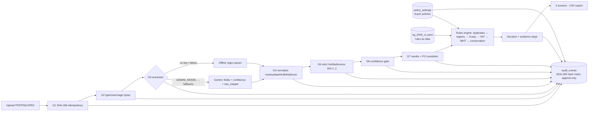

# ShieldLedger NG

**Pre-payment AP tax & leakage guard for Nigeria's 2026 tax regime.** Built for TCC'26 (Tech Conference Calabar) hackathon, sprint 22–24 Nov 2026.

## 1. What it is

ShieldLedger NG checks a batch of supplier invoices **before** a Nigerian company pays them. It runs a 3-way match (PO / goods-received note / invoice) and checks for duplicate and split purchases. It also checks each supplier's TIN against a taxpayer registry, and checks VAT validity under the Nigeria Tax Act 2025 (NTA). Finally, it computes the withholding tax (WHT) to deduct under the 2024 WHT Regulations. For every invoice it returns a **recommendation**: release, release partial, hold, blocked or needs human review. Each recommendation comes with an evidence trail: every number traces to a rule ID, its citation, an honesty label, and the exact text read from the document. A second screen monitors a Free Trade Zone enterprise's share of sales into the customs territory against the NTA 25% line.

**Who pays:** finance and AP teams at mid-size Nigerian manufacturers, agro-processors and FTZ enterprises (such as those in the Calabar Free Zone). Under the NTA Administration Act (NTAA) 2025 they face a ₦5,000,000 fine for contracting an unregistered person (s.100(2)). They also face a 40% penalty on WHT not deducted (s.105), and they lose input VAT when invoices are invalid. The product is a read-only decision-support layer in front of the payment run. It never moves money and never writes to the ERP.

> **LLM transcribes; Python decides.** An optional Gemini model only transcribes invoice fields, with a confidence score and raw snippet for each. All tax math, matching and decisions are deterministic Python on `decimal.Decimal`.

## 2. Demo video

TODO-VIDEO-URL

## 3. 60-second quickstart

Requires Python 3.11+, Node 18+ and `make`. **No API key needed.**

```bash
git clone <this repo> shieldledger-ng && cd shieldledger-ng
make setup      # venv + pip install + npm install
make seed       # create SQLite DB with the fictional master data
make dev        # API on :8000, UI on :5173
# open http://localhost:5173  → click “Load demo pack”
```

Other targets: `make test` runs the full suite, `make reset-demo` resets and re-ingests the pack (under 10 s), and `make build` builds the production UI. `make pack` regenerates the demo PDFs, `make register` regenerates `docs/STATUTORY_REGISTER.md`, `make calc` runs the independent golden calculator, and `make smoke-gemini` runs the Gemini check.

Optional: copy `.env.example` to `.env` and set `GEMINI_API_KEY` to enable Gemini transcription (needed for PNG/JPEG invoices).

## 4. Architecture



- **Layers:** `extraction/` (gates) → `engine/` (pure functions, Decimal in/out, each returns evidence steps) → `repo/` + `db.py` (the only SQL) → `api/` (FastAPI routers) → `frontend/`.
- **Rules as data:** every statutory value and citation lives in `backend/app/rules/ng_2026_v1.yaml` with `id, version, cite, status, source_url, note`. The engine never hard-codes a rate or a citation.
- **Evidence:** each `Decision` carries ordered `EvidenceStep`s (rule id/version, cite, status label, inputs, computation string, result, raw document snippet). Every decision ends with a conservation step: `net + WHT + held == gross`, exact Decimal equality.
- See [`docs/ARCHITECTURE.md`](docs/ARCHITECTURE.md) for data flow, money handling and the scaling path.

## 5. Sprint-Built Features (22–24 Nov 2026)

Everything in this repository was built during the sprint.

- **Foundation:** Decimal money helpers that never use floats (`money.py`), plus an AST test that fails the build on any float in `backend/app/`. Also built: the statutory register YAML with typed loader and buyer policies, the Pydantic v2 raw/verified/domain models with invariants INV-1..3, and the SQLite schema with append-only audit triggers and the hash-chained audit log.
- **Extraction (`extraction/`):** gates G1–G7, Gemini client with an env-driven model fallback chain, offline regex parser for the demo layout, per-document engine badge.
- **Engines (`engine/`):**
  - WHT on the approved base, with double rate when the payee has no TIN and policy-required categories.
  - VAT: input-VAT offset entitlement, an advisory when VAT is omitted on a standard-rated supply, and a hold on the VAT portion when a small, non-VAT-registered vendor charges VAT.
  - 3-way match: short delivery (with a fuel tolerance), price variance, unsigned GRN, no PO.
  - Registry guard, plus duplicate, split-PO and ghost-vendor detection.
  - FTZ monitor: share, bands, headroom, scenario and two interpretations.
  - `decide.py` orchestration.
- **API:** documents, evaluate, decisions + evidence, summary, policies (audited), rules, FTZ summary/scenario, audit list/verify, CSV export, dev reset, health.
- **Frontend:** the Payment Run, Exposure Summary and FTZ Monitor screens. Also an evidence drawer, a policy slide-over, the Statutory Register drawer, and an SVG gauge and bars with no chart library. Money is formatted with BigInt kobo, and the layout works down to 375 px.
- **Data & tooling:** fictional seed pack (12 invoices, PO/GRN, registry, payroll, PO/vendor traps, FTZ ledger), deterministic PDF generator, independent golden calculator, register generator, Gemini smoke script, trap report.

**Pre-Existing:** none. No code existed before 22 Nov 2026. `docs/planning/` is reserved for pre-sprint notes only (no code).

## 6. Statutory register & honesty

Every rule shown in the UI carries one of these labels:

| Label | Meaning |
|---|---|
| `SECONDARY_VERIFIED` | Supported by a law-firm / practitioner summary of the gazetted Act. Primary text **not** read. |
| `CONFLICTING` | Sources disagree; a toggle or buyer policy decides, default stated. |
| `BRIEF_ONLY` | From the build brief only; no independent source located. |
| `UNVERIFIED` | Not located in sources reviewed; used only as a label, warning or hold, never to charge money. |
| `BUYER_POLICY` | The buyer's own AP control or engine invariant. Not law. |

Nothing is labelled `VERIFIED_PRIMARY`.

**Most rule citations come from law-firm and tax-practitioner summaries of the gazetted Acts; verify against the Official Gazette (No. 117, Vol. 112, 26 June 2025) before relying on them.**

Open items (full list in [`docs/STATUTORY_REGISTER.md`](docs/STATUTORY_REGISTER.md)):

- **CONFLICTING:**
  - `FTZ_DOMESTIC_THRESHOLD`: effective date (1 Jan 2028 vs already live) and the boundary at exactly 25% are disputed. Toggle `FTZ_BOUNDARY`.
  - WHT on **rent**: 5% vs 10%, so there is no default and the buyer must set `WHT_RENT_RATE`.
  - `WHT_SMALL_PAYER_EXEMPT`: toggle, default OFF.
- **UNVERIFIED:**
  - `SMALL_BUSINESS_VAT_EFFECT`: we therefore only *hold the VAT portion*, never reject the invoice.
  - `TAX_ID_FORMAT`: warning chip only.
  - `FTZ_SUNSET` (2028-01-01): countdown only.
  - `FTZ_ARMS_LENGTH_OUTSOURCING`: flag only.
- **BRIEF_ONLY:** WHT 2% on goods and construction; `WHT_NO_TIN_DOUBLE`.
- **Section number unknown:** `SMALL_BUSINESS_DEF` (NTAA definition; the figures are secondary-verified).
- **Correction to the original spec:** input-VAT recovery is cited as **NTA s.156(1)/(5)**. An earlier draft said s.151, which sources do not support.
- **VAT omitted (s.155(2))** is modelled as an *advisory*. The Service **may** direct self-accounting; it is not an automatic charge, and the advisory is excluded from headline totals.

"Input VAT identified" is an **offset entitlement** the buyer would otherwise risk by paying invalid or over-invoiced amounts. **It is not cash received.** The two headline metrics, *Direct Cash Recovered & Saved* and *Contingent Statutory Fines Blocked*, are never added together. **This is not tax advice.**

## 7. Test evidence

```bash
make test        # cd backend && pytest
```

Result on 2026-11-23: **134 passed** (~25 s). No API key set; every pack document was extracted by `offline_regex`.

- Golden/unit T01–T20 are mapped to files in `backend/tests/` (`test_money_wht_vat.py`, `test_footing_gates.py`, `test_three_way.py`, `test_duplicates.py`, `test_split_po.py`, `test_ghost_vendor.py`, `test_registry_guard.py`, `test_ftz.py`, `test_audit_idempotency.py`, `test_offline_parser.py`, `test_no_float.py`, `test_e2e_pack.py`).
- Hypothesis properties H1–H6 are in `test_properties.py`: conservation, bounds, duplicate symmetry and invariance, FTZ headroom optimality, Decimal round-trip through DB and API, and quantize idempotence.
- The golden numbers (`backend/tests/golden/pack_expected.json`) were derived independently by `scripts/independent_calc.py`, which shares no code with `app/`, and a test checks that the two agree. **No golden mismatches.**
- `/api/summary` after ingesting the pack, to the kobo:
  - Gross ₦51,617,300.00 = net safe payable ₦43,435,420.00 + WHT ₦947,880.00 + blocked/hold ₦7,234,000.00
  - Direct cash ₦7,519,300.00
  - Contingent fines ₦5,379,152.00
  - Pending verification ₦1,805,250.00
  - Advisory ₦135,000.00
  - 1 invoice needs review

**Trap suite.** On the seeded pack (12 invoices, 2 PO-pattern traps/controls, 1 vendor-pattern trap/control): recall over traps **10/10 (100%)** and false positives over controls **0/7**. This is a regression check on fictional seeded data, not a claim of general accuracy. The full table is in [`reports/trap_report.md`](reports/trap_report.md), regenerated by every test run.

| Item | Kind | Scenario | Result |
|---|---|---|---|
| D01 | trap | Short delivery (GRN 94 of 100) | PASS |
| D03 | trap | Duplicate of D01 (invoice no. `O` for `0`, +9 days) | PASS |
| D04 | trap | Footing failure (₦1,523,000 printed vs ₦1,333,000) | PASS |
| D05 | trap | Missing TIN, so double WHT | PASS |
| D06 | trap | TIN not in registry, so BLOCKED + ₦5M exposure | PASS |
| D07 | trap | VAT omitted on standard supply, so advisory | PASS |
| D08 | trap | Small vendor charges VAT, so VAT held | PASS |
| D12 | trap | Price variance 1.579% | PASS |
| S1 | trap | Split PO (₦4.9M + ₦4.85M in 4 days) | PASS |
| G1 | trap | Vendor NUBAN = payroll NUBAN | PASS |
| D02, D09, D10, D11 | controls | price within tol. / clean / clean / AGO exempt within fuel tol. | PASS (no flags) |
| S0 ×2, G0 | controls | single near-limit PO; 12 days apart; NUBAN with no payroll match | PASS (no flags) |

Frontend: `npm run build` produces **59.98 KB gzip** JS and 4.51 KB gzip CSS (budget 200 KB). The demo path was checked in headless Chrome at 1400 px and 375 px, with no horizontal scroll at 375 px.

## 8. Scalability & production path

- **Database:** SQLite (WAL) sits behind `repo/` + `db.py`; no other module knows SQL. Moving to Postgres means re-implementing those two layers, using `NUMERIC(20,2)` for money (Decimal strings today) and a `BEFORE UPDATE/DELETE` trigger or `REVOKE` for audit immutability.
- **Extraction throughput:** gate G3 is the slow step. In production it moves to an async job queue (e.g. Redis/RQ or Cloud Tasks), with idempotent jobs keyed by the SHA-256 already computed in G1.
- **Multi-tenant:** add a `tenant_id` column on every table, keep a policy set per tenant (`policy_settings` is already key/value with audit), and use Postgres row-level security.
- **Rules versioning:** the pack is `ng_2026_v1`. Each evidence step stores `rule_id` + `rule_version`, so a later `ng_2027_v1` pack can coexist and old decisions stay reproducible.
- **Audit:** today there is an in-database hash chain plus `GET /api/audit/verify`. In production, the chain head would be anchored to WORM storage (S3 Object Lock) on a schedule.
- **Security:** add auth/RBAC (AP clerk, reviewer, tax lead, auditor) with an OIDC provider; the policy-change audit already records an `actor` field. Add rate limits on upload and evaluate. Uploads are already capped at 10 MB each and 64 MB per request, with magic-byte checks.
- **Integration:** read-only exports (CSV today; SAP/Sage/QuickBooks import formats next). No ERP write-back.
- **What we deliberately don't do:** execute payments, file or remit tax, claim NRS system-integrator status, or auto-merge vendors.

## 9. Limitations

- The offline parser only handles the demo-pack `Label: value` layout. Other PDFs go to human review (a validation or low-confidence flag), not to a guess.
- Images (PNG/JPEG) need Gemini. Without it they go to `NEEDS_HUMAN_REVIEW` with `OFFLINE_NO_OCR`.
- **Gemini 3.x structured-output status:** untested. `scripts/smoke_gemini.py` was run on 2026-11-23 with **no `GEMINI_API_KEY` present** and reported `SKIPPED`. The Gemini path (`gemini-3.8-flash` → `gemini-3.6-flash` → `gemini-2.5-flash-lite`) is covered only by mocked tests: chain order, schema-failure fallback, and per-model failure recording. The demo runs entirely on `offline_regex`. Run `make smoke-gemini` with a key before relying on it.
- The taxpayer registry is a seeded fictional table, not a live NRS lookup.
- All thresholds (price/quantity tolerances, duplicate fuzz and window, split-PO band, PO approval limit) are buyer-configurable policies, not law.
- The FTZ interpretation panel uses a user-entered illustrative profit and shows two readings; it does not decide which applies.
- WHT late-remittance interest is shown only as a due date (21st of the following month). Interest needs a user-entered MPR and is excluded from totals.
- Single-tenant demo with no authentication.

## 10. AI Tools Disclosure

Code written with Claude (Claude Code). Runtime extraction uses Google Gemini, optional.

All tax rules, statuses and golden numbers come from the build brief. They were cross-checked by an independent calculator script and by tests. Nothing in the statutory register was generated by an AI as fact.

## 11. Fictional data notice

Every vendor, TIN, NUBAN, phone number, employee, customer and the buyer (*Qua River Agro-Processing FZE*, Calabar Free Zone) is **fictional**. Any resemblance to a real entity is coincidental. The seeded amounts illustrate the engine; they are **not** market data and **not** real savings. The UI footer says this on every screen.

## 12. Team / contact

Shar-le, solo builder, TCC'26. Contact: TODO (add handle/email before submission). #CTCHackathon2026 #TechConferenceCalabar
