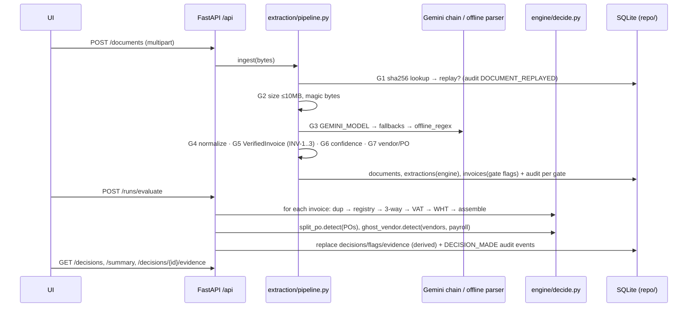

# Architecture

## Principles

1. **LLM transcribes; Python decides.** Gemini (optional) returns fields, a per-field confidence and a `raw_snippet`. It never computes. Every amount, match and status is produced by pure Python functions on `decimal.Decimal`.
2. **Rules as data.** Statutory values, citations and honesty labels live in `backend/app/rules/ng_2026_v1.yaml`. Buyer thresholds live in `policy_settings`. The engine reads both.
3. **Evidence or it didn't happen.** Every engine function returns `(result, evidence_steps)`. A `Decision` is the sum of its evidence plus a closing conservation step.
4. **Read-only.** Output is a recommendation and an evidence pack. No payment execution and no ERP write-back.
5. **Fail loud, not silent.** Unknown values become explicit statuses (`POLICY_REQUIRED`, `NEEDS_HUMAN_REVIEW`, `OFFLINE_NO_OCR`). A failed LLM falls back to the offline parser, and the engine that produced each extraction is persisted and shown.

## Gemini circuit breaker

- Each Gemini call has an 8 s timeout (`GEMINI_TIMEOUT_MS`).
- One upload request, or one `reset-demo`, is one batch. A `Breaker` is shared across the batch:
  - No key: Gemini is never called.
  - A timeout, auth error (for example `API_KEY_INVALID`) or network error stops the model chain at once, because no fallback model can fix it. The breaker opens.
  - A model-specific failure (schema mismatch, unknown model) tries the next fallback for that document. If the whole chain fails, the breaker opens.
  - Once the breaker is open, the remaining documents in the batch go straight to the offline parser. Each one records a `skipped` attempt with the reason in `extractions.attempts_json` and the G3 audit event.
- `/api/health` reports `gemini_state` (`not_configured`, `configured_unused`, `active` or `failing`). `gemini_active_model` is set only after a real successful call. The UI header reads these fields.

## Data flow

## Decision order (`engine/decide.py`)

1. Gate failures (footing, low confidence on a critical field, offline image, validation) give `NEEDS_HUMAN_REVIEW`. The invoice is excluded from all totals but stays visible and audited.
2. Duplicate: `HOLD` on the full gross, recorded as `overpayment_blocked = gross`. Evaluation **stops** here so the invoice is not double counted.
3. Registry guard:
   - TIN not in the registry: `BLOCKED`, full gross held as pending verification, and a contingent exposure of ₦5,000,000 (NTAA s.100(2)). Evaluation stops.
   - TIN missing: flag `MISSING_TIN_DOUBLE_WHT` and continue.
4. 3-way match per line: unsigned GRN, short delivery (fuel tolerance on LITRE/FUEL lines), and price variance (strictly greater than tolerance). This gives the approved base. No PO gives `HOLD`.
5. VAT (supply type from the PO line):
   - recoverable input VAT, only with STANDARD treatment, a registered vendor, a TIN on the invoice and VAT charged;
   - an advisory when VAT is omitted;
   - a hold on the VAT portion when a small, non-VAT-registered vendor charges VAT.
6. WHT on the approved base by category. RENT/OTHER without a policy raises `PolicyRequired`, which routes to review.
7. Assemble. `net = approved_gross − WHT` and `held = gross − approved_gross`. Held is split into `overpayment_blocked` (duplicate, short delivery, price) and `pending_verification` (unregistered, unsigned GRN, no PO, small-vendor VAT). The engine asserts `net + WHT + held == gross` and `overpay + pending == held`, with exact Decimal equality.

## Money

- `decimal.Decimal` everywhere with `prec = 28`, quantized with `q()` (kobo, `ROUND_HALF_UP`) only at defined points: line approval, VAT, WHT, s.105 penalty and FTZ interpretations.
- **SQLite has no decimal type, so money columns are `TEXT` holding Decimal strings** (`"5106250.00"`). They are read back with `Decimal(text)`. Property test H5 checks the round-trip through the DB and the API.
- The API serializes money as **strings**. The UI formats with BigInt kobo (`frontend/src/money.ts`) and does no float math.
- `tests/test_no_float.py` AST-scans `backend/app/` and fails on any `float(` call or float literal. The YAML loader rejects unquoted float literals.
- FTZ: amounts derived from the share use the exact ratio `D/T`. The 6-dp share is for display only.

## Persistence & audit

- SQLite in WAL mode with foreign keys on. Each request opens its own connection, and writes run in `BEGIN IMMEDIATE` transactions.
- `audit_events(id, ts, actor, event_type, entity_type, entity_id, payload_json, prev_hash, hash)` with `hash = sha256(prev_hash ‖ canonical_json(envelope))`. The envelope is `{ts, actor, event_type, entity_type, entity_id, payload}`, so editing any column breaks the chain, not only the payload.
- `BEFORE UPDATE` / `BEFORE DELETE` triggers `RAISE(ABORT, 'audit_events is append-only')`. `GET /api/audit/verify` recomputes the chain and returns `{ok, checked, first_bad_id}`.
- Logged events: document intake, replay and rejection; each gate G3–G7; each decision; each evaluation run (with a digest); each policy change (old → new).
- Derived tables (`decisions`, `flags`, `evidence_steps`) are rebuilt by each evaluation. Evaluation is idempotent: the same inputs give identical decisions, which is tested.
- `POST /api/dev/reset-demo` (only when `APP_ENV=dev`) deletes the database file and re-seeds. This is a dev convenience, not a production path.

## Scaling path

| Concern | Today (demo) | Production |
|---|---|---|
| DB | SQLite file, `repo/` layer | Postgres `NUMERIC(20,2)`, same repo interface, RLS per tenant |
| Extraction | synchronous in request | async job queue keyed by document SHA-256; retries; per-model circuit breaker |
| Rules | `ng_2026_v1.yaml`, rule_version on every evidence step | versioned packs per effective date; pack chosen by invoice date |
| Policies | one `policy_settings` set | per-tenant policy sets, approval workflow for changes |
| Audit | in-DB hash chain + verify endpoint | periodic anchoring of the chain head to WORM storage (S3 Object Lock) |
| Access | single-tenant, no auth | OIDC + RBAC (clerk / reviewer / tax lead / auditor), actor on every event |
| Limits | 10 MB per file, 64 MB per request, magic bytes | + per-tenant rate limits, malware scanning |
| Output | UI + CSV | read-only ERP import formats; no write-back |
